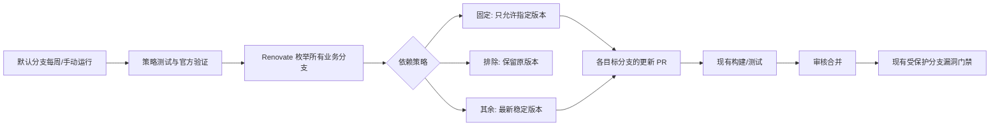

> 2026-10-14 更新：以下内容保留为旧实现记录。当前执行契约、脚本和配置以 `docs/weekly-dependencies.md`、`.github/workflows/weekly-dependencies.yml`、`.github/dependency-policy.json` 与 `scripts/dependencies/check_dependencies.py` 为准；每个分支均保留 CI，读取目标分支策略。下文已退役的 Renovate/旧脚本路径不再作为运行指引。

# 每周全分支依赖维护

- 日期：2026-10-14
- 事实源：本仓现有 Superpowers 规格。
- 范围：新增 GitHub Actions 与集中依赖策略；不改变当前 POM、分支或已有漏洞门禁。

## 行为与验收

1. 每周一北京时间 10:17 执行，支持手动运行；Renovate 动态发现全部分支，排除自己的 `renovate/` 更新分支，新增业务分支自动覆盖。没有依赖文件的分支正常无更新。
2. 未受约束的依赖提出最新稳定版更新 PR，包括 major；不自动合并。保留 POM 的确定版本，不在构建时使用 LATEST。
3. 单一 `.github/dependency-policy.json` 支持全局/分支级固定版本、版本范围、排除坐标。Quarkus 两条维护线分别固定为 3.37.4 / 3.38.2，BOM 和插件一起受约束；上游 ddd4j 发布线显式排除，防止跨底座升级。
4. 固定版本通过精确候选约束实现，排除项不创建更新 PR；两者都不豁免现有 OWASP 漏洞扫描。上游 BOM 间接管理的依赖须在上游仓库升级，不能声称此任务直接改写其版本。
5. PR/push 执行无凭据策略测试、官方配置验证和 workflow lint；只有 schedule / dispatch 默认分支运行更新机器人。使用专用 token 触发更新 PR 的正常 CI，不使用 GITHUB_TOKEN 创建 PR。
6. 每个分支的机器人分支名隔离；无 PR 数量/小时上限延迟可用升级。报告分支、依赖和更新结果的 Renovate 日志保留为 Actions artifact。
7. 完成证据区分本地配置验证与真实 Actions/PR/合并；默认分支部署和 secret 缺失时，不能称每周任务已启用。版本最新不等于不存在漏洞。

## 执行与验证

- 实施顺序：测试缺失装配行为 → 策略与装配器 → workflow → 本地测试/schema/actionlint → 文档。
- 不安装或初始化新规格体系，不切换分支，不提交推送。
- 远端验收：合入 master、配置 RENOVATE_TOKEN、手动运行一次；核对分支处理日志、固定/排除结果、更新 PR 及其构建结果。

## 本轮证据（2026-10-14）

- 已交付集中策略、单仓库配置装配器、每周全分支更新 workflow、README 与配置/启用说明；`.gitignore` 为策略 JSON 单独开放跟踪。
- Node 策略测试 6/6 通过；新 workflow 的 actionlint 与 `git diff --check` 通过。
- Renovate 44.155.9 官方 `renovate-config-validator --strict`：策略及实际装配后的全局配置均通过，无 warning。官方 repository/global JSON schema 也已校验。
- 未修改 Java/POM，未执行 Maven 构建；未提交、推送或触发远端 CI。
- 默认分支部署、RENOVATE_TOKEN / 按需私仓认证、真实分支扫描与更新 PR、PR 构建验收仍待执行；本轮配置交付不等于定时任务已在远端启用。
